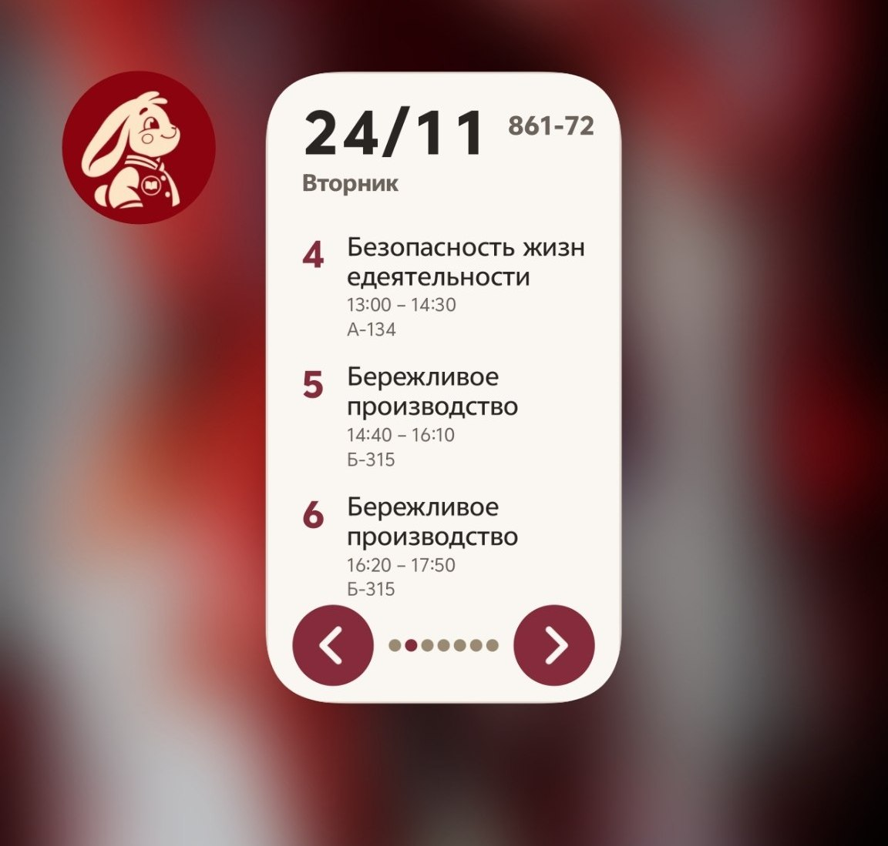
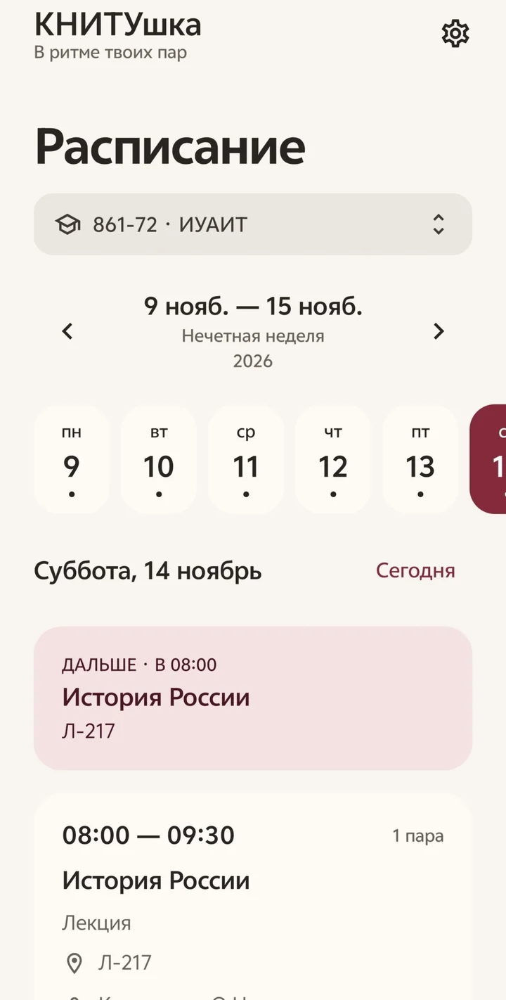
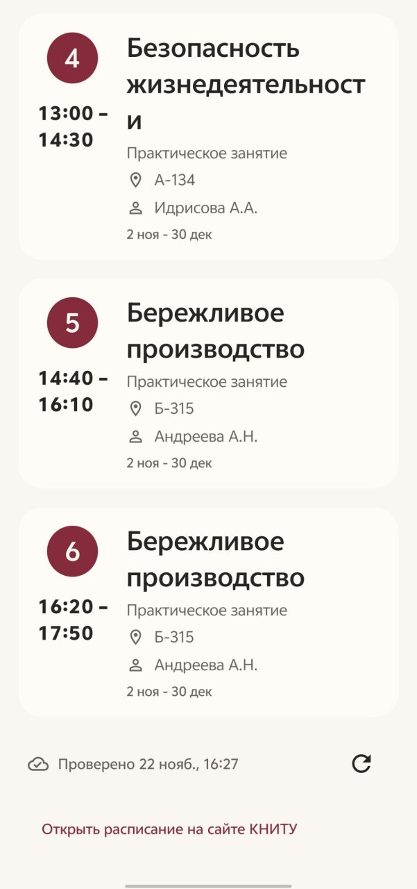
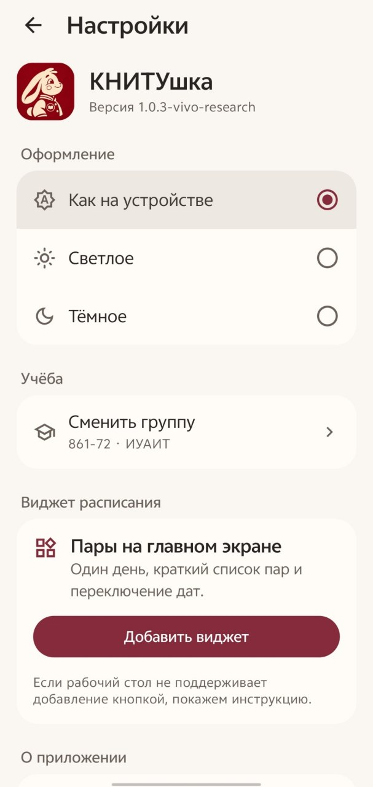

<div align="center">


# КНИТУшка / KNITUshka

**Расписание КНИТУ под рукой — в том числе без интернета.**

[Android](android/) [Kotlin](android/app/build.gradle.kts) [Jetpack Compose](android/) [MIT License](LICENSE) [GitHub Release](https://github.com/wesdyqq/KNITUshka/releases/latest) [Android CI](https://github.com/wesdyqq/KNITUshka/actions/workflows/android-ci.yml)

[Скачать Android-версию](https://github.com/wesdyqq/KNITUshka/releases/latest) · [Сообщить об ошибке](https://github.com/wesdyqq/KNITUshka/issues/new/choose)

</div>

---

КНИТУшка — неофициальное open-source приложение для студентов Казанского национального исследовательского технологического университета. Выбери институт и группу при первом запуске — дальше приложение открывает расписание сразу.

Данные загружаются с [сайта КНИТУ](https://www.kstu.ru/www_GFgrid.jsp). Аккаунт и отдельный сервер не нужны.

## Возможности

- **Расписание по дням и неделям:** предметы, время, аудитории, преподаватели и типы занятий.
- **Свайпы и кнопки:** переключение дней и недель, быстрый возврат на сегодня.
- **Офлайн:** загруженные недели сохраняются на устройстве; сбой сайта не удаляет последнее расписание.
- **Обновление данных:** автоматически и вручную, с отметкой времени проверки.
- **Оформление:** светлая, тёмная и системная темы; выделение текущей и следующей пары.
- **Виджет 2×3:** переключение дат кнопками, индикатор дней недели и открытие выбранного дня в приложении.

> Первому запуску нужен интернет. Офлайн доступны только уже загруженные недели. Android может откладывать фоновые проверки. Время занятий — казанское (МСК).

## Скачать и установить

Открой [последний Android-релиз](https://github.com/wesdyqq/KNITUshka/releases/latest) и скачай APK из **Assets**.

1. На телефоне открой скачанный APK.
2. Если Android попросит, разреши установку из выбранного браузера или файлового менеджера.
3. Подтверди установку и выбери институт и группу.

Требуется **Android 7.0 или новее**. При переходе с локальной debug-версии на release Android может потребовать удалить старую установку из-за другой подписи; при этом локальные данные будут потеряны.

## Скриншоты

Виджет, расписание и настройки.

<div align="center">
<table>
  <tr>
    <td align="center" width="25%" valign="top"></td>
    <td align="center" width="25%"></td>
    <td align="center" width="25%"></td>
    <td align="center" width="25%"></td>
  </tr>
  <tr>
    <td align="center">Виджет</td>
    <td align="center" colspan="2">Расписание дня</td>
    <td align="center">Настройки</td>
  </tr>
</table>
</div>

## Структура репозитория

```
KNITUshka/
├── android/                 # Kotlin + Jetpack Compose, Gradle Wrapper и тесты
├── ios/                     # Место для готовящейся iOS-версии
├── docs/                    # Сборка, архитектура, публикация релизов
├── .github/
│   ├── actions/             # Общее окружение Android-сборки
│   └── workflows/           # Android CI и подписанные релизы по тегам
├── README.md
├── LICENSE
└── CONTRIBUTING.md
```

## Roadmap

Реализованные возможности описаны выше. Дальше планируются:

- [ ] Расписание экзаменов.
- [ ] Напоминания перед парами.
- [ ] Экспорт в календарь.
- [ ] Дальнейшие проверки доступности и интерфейса на разных устройствах.
- [ ] iOS-версия на Swift + SwiftUI — готовится отдельно.

Эти возможности пока не доступны в Android-приложении.

## Участие в разработке

Баг-репорты, предложения и pull requests приветствуются. Прежде чем менять поведение приложения, опиши задачу в [Issues](https://github.com/wesdyqq/KNITUshka/issues).

[Правила участия →](CONTRIBUTING.md) · [Как устроено Android-приложение →](docs/architecture.md)

## Лицензия

Код распространяется под [MIT License](LICENSE). Copyright © 2026 Камиль Сафьянов.

Приложение не является официальным сервисом КНИТУ. Расписание, названия и университетская символика принадлежат соответствующим правообладателям; MIT-лицензия проекта не изменяет их права и условия использования внешнего сайта.
